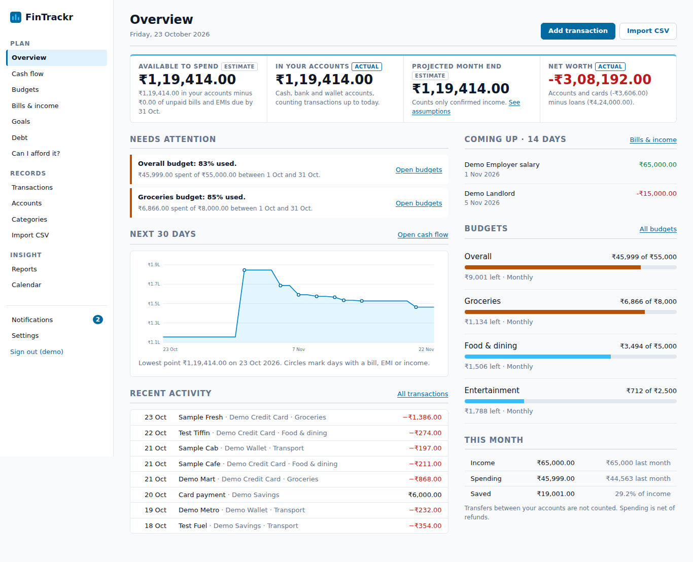
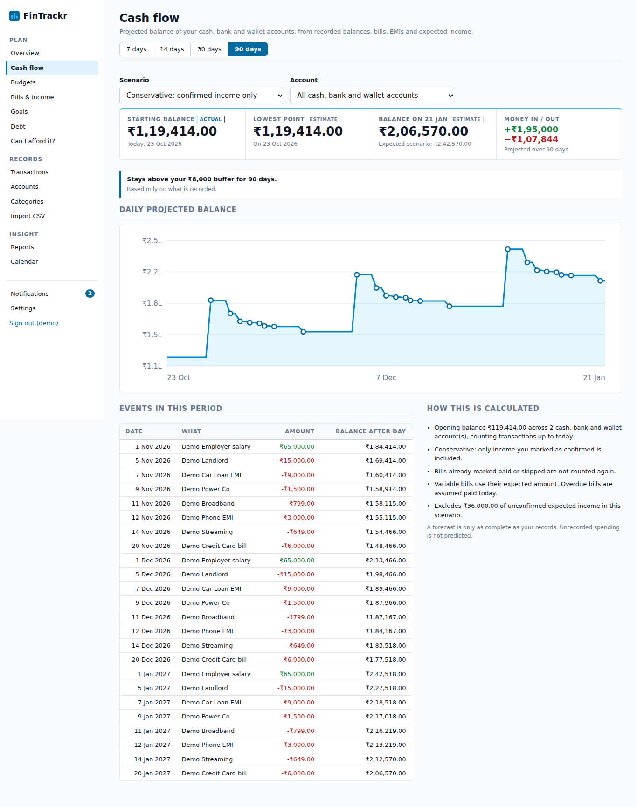

# FinTrackr

A personal finance planning app built around one question: **given the money I have, the income I can reasonably expect,
and the bills I have to pay, what can I afford?**

It is a Django application with server-rendered pages. It does not connect to banks, UPI or lenders; you record or import
your own data. It works without any external service or AI.

## Screenshots
These are captured from the running app with the synthetic demo data (`python manage.py seed_demo`).

| Overview | Cash flow |
|---|---|
|  |  |

More in [`docs/screenshots`](docs/screenshots): transactions, budgets, bills, debt, goals, reports, calendar, "can I afford it" and mobile views.

## What it solves
Expense trackers tell you what you already spent. FinTrackr also looks forward: it combines your balances, recorded
bills, EMIs and expected income into a day-by-day projection, warns before the balance dips under a buffer you choose,
and lets you test a purchase against that projection.

## Implemented features
- **Overview**: balance, available-to-spend, projected month end, net worth, each labelled *Actual* or *Estimate* with its reason; alerts; 30-day forecast; upcoming items; budget pace.
- **Accounts and transactions**: multiple accounts (cash, bank, wallet, credit card), opening balances; expense, income, refund, transfer; categories with subcategories and an essential flag; payee, tags, payment method, notes; search, filters, sorting, pagination; bulk categorise and delete; CSV export.
- **CSV import**: column mapping, debit/credit or signed amounts, Indian formats, preview with a validation report, duplicate detection that makes re-imports safe, import history.
- **Cash flow**: 7/14/30/90-day projection, conservative and expected scenarios, per-account view, lowest point, first shortfall, assumptions listed beside every forecast.
- **Budgets**: monthly and weekly, overall or per category (subcategories roll up), warn thresholds, pace and projected spend, previous-period comparison, essential vs discretionary.
- **Bills and income**: weekly/monthly/quarterly/yearly/one-off schedules with correct month-end and leap-year handling; paid/skipped/overdue states; variable amounts; subscriptions; credit-card bills recorded as transfers; undo; paying is idempotent.
- **Debt**: EMI payoff estimates, extra-payment scenarios, payment history, avalanche vs snowball.
- **Goals**: targets, deadlines, contribution history, required monthly amount, estimated completion.
- **Can I afford it?**: a purchase compared now vs later against the forecast and your buffer; warns when your records are incomplete.
- **Reports**: period comparison, category and merchant breakdowns, 6-month income vs spending, recurring costs, explainable insights that show the figures behind them, CSV export.
- **Calendar**: month and agenda views of bills, EMIs, income and goal dates.
- **Notifications**: in-app, de-duplicated, configurable per type.
- **Privacy**: per-user isolation, full JSON data export, account deletion with password confirmation.

## Not implemented yet
Household/shared expenses and settlements, transaction splitting, account reconciliation, attachments, budget rollover,
custom-period budgets, a REST API, email reminders, background workers, bank/UPI integrations. See the roadmap.

## Stack and layout
Python 3.12, Django 5.2, SQLite (default), WhiteNoise, gunicorn. No JavaScript framework; charts are server-rendered SVG.

```
expense_tracker/   settings, root URLs
core/              auth pages, overview, notifications, settings, formatting, template tags, seed_demo command
ledger/            accounts, categories, transactions, balances, CSV import/export
planner/           budgets, bills/income, debts, goals, forecast, reports, calendar
templates/ static/ docs/ .github/workflows/
```
Calculation rules and definitions: [`docs/ARCHITECTURE.md`](docs/ARCHITECTURE.md). Design tokens: [`docs/DESIGN.md`](docs/DESIGN.md).
The original project was a Django app; this work extended it in place rather than switching to React/DRF.

## Getting started
Prerequisites: Python 3.12+.

```bash
python -m venv .venv && source .venv/bin/activate
pip install -r requirements-dev.txt
cp .env.example .env            # FINTRACKR_DEBUG=1 is set for local use
python manage.py migrate
python manage.py runserver
```
Open http://127.0.0.1:8000, register, and follow the setup page. For sample data run `python manage.py seed_demo`
(creates user `demo` with a random password, printed once; `--reset` recreates it). All demo data is synthetic and tagged `demo`.

### Upgrading an existing database
`python manage.py migrate` copies your old expenses into a "Cash (migrated)" account and your old monthly limit into an
overall budget; the old tables are left untouched. The new account's opening balance is set so today's balance is ₹0;
**edit it to match reality**. Back up `db.sqlite3` first and keep it out of Git.

## Configuration
Environment variables (or `.env`): `FINTRACKR_DEBUG`, `FINTRACKR_SECRET_KEY` (required unless debug), `FINTRACKR_ALLOWED_HOSTS`,
`FINTRACKR_CSRF_TRUSTED_ORIGINS`, `FINTRACKR_DB_PATH`, `FINTRACKR_HTTPS`, `FINTRACKR_BEHIND_PROXY`. See `.env.example`.

## Tests and lint
```bash
python manage.py test
ruff check . && ruff format --check .
python manage.py makemigrations --check --dry-run
```
Tests cover balances, transfers and refunds, credit-card handling, budgets, the forecast engine and its double-counting rules,
recurrence month-end/leap-year cases, EMI and payoff maths, goals, CSV parsing/validation/duplicates, notification
de-duplication, authentication, cross-user isolation, bulk actions, and the main workflows end to end. There are no
browser-based tests; the small amount of JavaScript (show/hide the transfer field, select-all) is untested and optional.
GitHub Actions (`.github/workflows/ci.yml`) runs lint, format check, migration check, collectstatic, tests and `check --deploy`.

## Deployment
```bash
export FINTRACKR_SECRET_KEY=...            # python -c "from django.core.management.utils import get_random_secret_key as g; print(g())"
export FINTRACKR_ALLOWED_HOSTS=fintrackr.example.com
export FINTRACKR_CSRF_TRUSTED_ORIGINS=https://fintrackr.example.com
export FINTRACKR_BEHIND_PROXY=1            # if TLS terminates at a proxy that sets X-Forwarded-Proto
python manage.py migrate && python manage.py collectstatic --noinput
gunicorn expense_tracker.wsgi --bind 0.0.0.0:8000
```
Serve over HTTPS. Put the SQLite file on persistent, backed-up, encrypted storage, or move to PostgreSQL before hosting for several people.

## Security and privacy
See [`SECURITY.md`](SECURITY.md). Notably: **there is no login rate limiting**, no email verification, no password reset and
no 2FA, and there has been no independent security review. Do not host this publicly for others without addressing those.

## Known limitations
- Forecasts only know what you record: unrecorded spending is not predicted, and income due before today that was not marked received is ignored.
- Debt figures are calculated estimates, not lender-confirmed; lenders' interest conventions differ.
- Notifications are generated when you open the app, not pushed.
- INR only. SQLite only (tested). English only.
- Goal contributions do not move money between accounts.
- No automated accessibility audit has been run.

## Roadmap
Household workspace with roles and settlements; transaction splitting; reconciliation; login throttling, password reset and 2FA;
PostgreSQL support; scheduled notification delivery; custom-period budgets and rollover; REST API.

## Licence
None chosen yet. Add a `LICENSE` file before accepting outside contributions; see [`CONTRIBUTING.md`](CONTRIBUTING.md).
